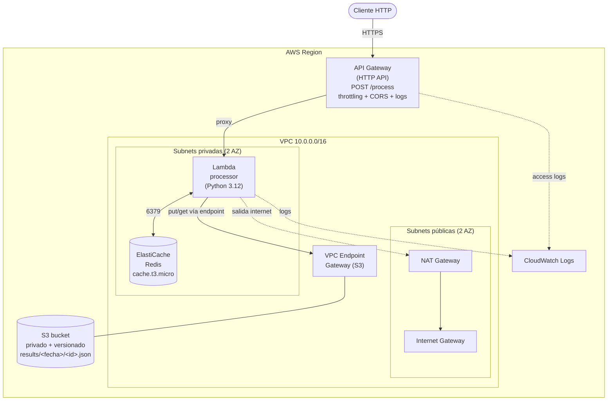

# Servicio de Procesamiento de Datos Serverless (AWS)

Arquitectura serverless, segura y reproducible que integra **VPC, API Gateway, Lambda, ElastiCache Redis y S3**, desplegada por completo con **Terraform**.

El servicio recibe peticiones HTTP, procesa el payload en una Lambda, cachea el resultado en Redis (TTL 60s) y lo persiste en S3. Dos peticiones idénticas consecutivas devuelven `X-Cache: MISS` y luego `X-Cache: HIT`.

Sigue el [manual de despliegue paso a paso](./MANUAL-DESPLIEGUE-AWS.md), para desplegarlo en tu propio AWS.

---

## Diagrama de arquitectura



### Flujo de datos

```
Cliente → API Gateway → Lambda (VPC privada) → Redis
    ├─ HIT  → devuelve valor cacheado           (X-Cache: HIT)
    └─ MISS → procesa → guarda en S3 → escribe Redis TTL 60s → responde (X-Cache: MISS)
```

---

## Estructura del repositorio

```
solucion/
├── README.md
├── arquitectura-explicada.html      # HTML educativo para entender todo
├── lambda/
│   ├── handler.py                   # Código de la Lambda
│   └── requirements.txt             # redis-py (boto3 ya está en el runtime)
├── terraform/
│   ├── versions.tf                  # Providers y versión mínima
│   ├── providers.tf                 # Provider AWS + default tags
│   ├── variables.tf                 # Variables parametrizadas
│   ├── terraform.tfvars.example     # Ejemplo de valores
│   ├── locals.tf                    # AZs, prefijo de nombres, caller identity
│   ├── network.tf                   # VPC, subnets, IGW, NAT, VPC Endpoint, SGs
│   ├── s3.tf                        # Bucket privado, versionado, policy
│   ├── redis.tf                     # ElastiCache Redis + subnet group
│   ├── lambda.tf                    # Build, IAM, función en VPC
│   ├── apigateway.tf                # HTTP API, ruta, throttling, CORS, logs
│   └── outputs.tf                   # URLs y nombres de recursos
└── evidence/
    ├── README.md                    # Cómo capturar la evidencia
    └── capturar-evidencia.sh        # Script que genera MISS + HIT + S3 ls
```

---

## Prerrequisitos

| Herramienta | Versión | Para qué |
|---|---|---|
| Terraform | >= 1.5.0 | Desplegar la infraestructura |
| AWS CLI | >= 2.x | Credenciales y verificación (`aws s3 ls`, `aws logs`) |
| Python | 3.12 (o 3.9+) | Empaquetar la Lambda (`pip` descarga wheels de Linux) |
| `curl` | cualquiera | Probar el endpoint |

**Permisos AWS necesarios** (la identidad que ejecuta Terraform): crear y gestionar recursos de EC2/VPC, Lambda, API Gateway v2, ElastiCache, S3, IAM, CloudWatch Logs. En una cuenta de laboratorio, un rol con `AdministratorAccess` cubre todo.

Configura tus credenciales antes de desplegar:

```bash
export AWS_ACCESS_KEY_ID=...
export AWS_SECRET_ACCESS_KEY=...
export AWS_REGION=us-east-1
# o: aws configure
```

---

## Despliegue desde cero

```bash
cd terraform

# (opcional) ajusta valores
cp terraform.tfvars.example terraform.tfvars

terraform init
terraform apply        # un solo comando crea TODO el stack
```

Al terminar verás los outputs, incluido `process_url`.

> **Tiempo**: ElastiCache tarda unos minutos en crearse; el `apply` completo ronda los 8–12 min.

Recupera la URL cuando quieras:

```bash
terraform output -raw process_url
```

---

## Verificar el flujo end-to-end

```bash
API_URL=$(terraform output -raw process_url)

# 1ª llamada → MISS
curl -s -i -X POST "$API_URL" \
  -H 'Content-Type: application/json' \
  -d '{"message":"hola sre"}' | grep -i x-cache

# 2ª llamada idéntica → HIT (dentro de los 60s de TTL)
curl -s -i -X POST "$API_URL" \
  -H 'Content-Type: application/json' \
  -d '{"message":"hola sre"}' | grep -i x-cache
```

Salida esperada:

```
x-cache: MISS
x-cache: HIT
```

Verifica el objeto en S3:

```bash
BUCKET=$(terraform output -raw s3_bucket_name)
aws s3 ls "s3://$BUCKET/results/" --recursive
```

Puedes automatizar la evidencia con:

```bash
cd ../evidence && ./capturar-evidencia.sh
```

---

## Decisiones de diseño

**HTTP API vs REST API → HTTP API (API Gateway v2).**
Es ~70% más barata, tiene menor latencia, CORS nativo e integración proxy con Lambda más simple. No necesitamos las features avanzadas de REST API (API keys por uso, validación de request con modelos, WAF nativo por método), así que HTTP API es la opción correcta en costo/complejidad.

**Tipo de nodo Redis → `cache.t3.micro`.**
Es el nodo más económico ampliamente disponible y sobra para una capa de caché con TTL corto. Un solo nodo (sin réplica) es suficiente para la prueba; en producción se añadiría réplica multi-AZ.

**Lambda en subnets privadas + NAT + VPC Endpoint.**
La Lambda no es accesible desde internet. Para hablar con Redis usa la red privada; para S3 usa el **VPC Endpoint tipo Gateway**, de modo que ese tráfico nunca sale a internet. El NAT Gateway solo cubre la salida restante (p. ej. llamadas a otros servicios de AWS por endpoint público).

**Seguridad de red con mínimo privilegio.**
El SG de Redis solo acepta el puerto 6379 **desde el SG de la Lambda** (no por CIDR). La Lambda no tiene reglas de ingress. El bucket S3 tiene Block Public Access en las 4 opciones y una bucket policy que **niega todo lo que no sea el rol de la Lambda** y fuerza TLS.

**Clave de caché determinista.**
Se deriva un `sha256` del body del request, así dos requests idénticos comparten key → el segundo es HIT. El TTL de 60s se escribe explícitamente en cada `SET` (no hay persistencia indefinida).

**Empaquetado reproducible de la Lambda.**
`terraform apply` instala `redis-py` con wheels `manylinux` para `python3.12` y arma el zip automáticamente, de forma que no hay pasos manuales de build.

---

## Servicios adicionales usados

- **CloudWatch Logs**: logs de ejecución de la Lambda y logs de acceso de API Gateway (observabilidad y requisito de la prueba).
- **IAM**: rol de ejecución de la Lambda con permisos mínimos (logs, ENIs de VPC, acceso al bucket).
- **random**: sufijo único para el nombre global del bucket S3.

---

## Limpieza

```bash
cd terraform
terraform destroy
```

El bucket usa `force_destroy = true` para poder eliminarse aunque tenga objetos versionados (entorno de prueba).

---

## Nota sobre LocalStack

El stack está pensado para AWS real. Para LocalStack habría que apuntar los endpoints del provider a `http://localhost:4566` y tener en cuenta que ElastiCache tiene soporte parcial; para una demo local, lo más fiable es ejecutar un Redis en contenedor y simular el resto. En AWS real todo funciona tal cual.
